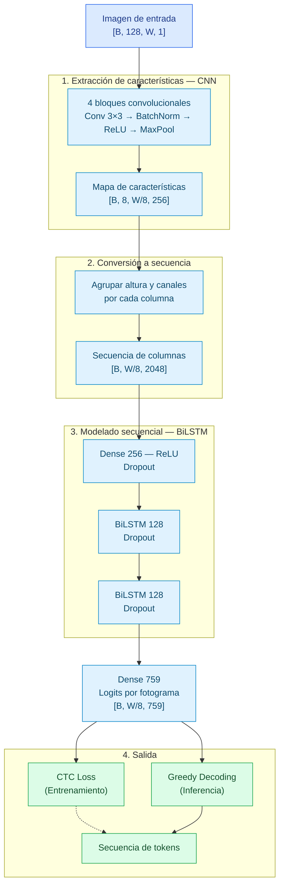

# Arquitectura y entrenamiento

Este documento describe el modelo de NoteVision, cómo se entrena y cómo se usa para predecir. Los datos y las etiquetas están en [`dataset.md`](dataset.md); las métricas y el análisis de errores, en [`evaluation.md`](evaluation.md).

> **Estado:** describe el modelo inicial (**EXP-00**). La variante **EXP-01** (reducción horizontal ×4) está en entrenamiento.

---

## 1. Visión general

El modelo es una **CRNN** (red convolutiva recurrente) entrenada con pérdida **CTC**, basado en el trabajo de Shi et al. (2017) para reconocimiento de texto en imágenes y de Calvo-Zaragoza y Rizo (2018) para OMR (Reconocimiento Óptico de Música) sobre PrIMuS (dataset seleccionado para este proyecto).

- **Entrada:** imagenes de un pentagrama impreso (digital), en escala de grises, de alto fijo (128px) y ancho variable (véase Bucketing).
- **Salida:** secuencia de tokens *agnósticos* (símbolo y posición en el pentagrama, e.g.: `note.quarter-S2`), de izquierda a derecha. El vocabulario tiene 758 tokens.
- **Por qué CTC:** el dataset no trae el alineamiento entre cada símbolo y su posición horizontal en la imagen. CTC permite entrenar solo con la secuencia de etiquetas.

## 2. Representación de entrada y salida

**Entrada** (idéntica en entrenamiento, evaluación y `code/predict.py`):

1. Conversión a escala de grises.
2. Redimensionado a **alto de 128px** conservando la proporción.
3. Normalización con **tinta = 1** y **fondo = 0**.
4. Relleno con ceros por la derecha hasta el límite de su cubeta de ancho (véase Bucketing: sección 4).

**Salida:** clases 0 a 758.

- La clase **0 es el blanco de CTC**.
- El token con identificador *i* corresponde a la clase *i + 1*. El desplazamiento se aplica dentro de la pérdida y al decodificar; las etiquetas y las métricas usan siempre los identificadores originales (0 a 757).
- La longitud máxima de una etiqueta es de **75 tokens**.

## 3. Capas del modelo

La reducción horizontal total es x8, así que cada **fotograma** (time step) cubre unos 8px de la imagen reescalada. La reducción vertical es de x16, de 128 a 8.

| Bloque | Operación | Salida (sin lote) | Parámetros entrenables |
|---|---|---|---|
| Entrada | imagen en escala de grises | 128 × W × 1 | – |
| Conv 1 | Conv 3×3, 32 filtros, BatchNorm, ReLU, MaxPool 2×2 | 64 × W/2 × 32 | 288 |
| Conv 2 | Conv 3×3, 64 filtros, BatchNorm, ReLU, MaxPool 2×2 | 32 × W/4 × 64 | 18 432 |
| Conv 3 | Conv 3×3, 128 filtros, BatchNorm, ReLU, MaxPool 2×2 | 16 × W/8 × 128 | 73 728 |
| Conv 4 | Conv 3×3, 256 filtros, BatchNorm, ReLU, MaxPool 2×1 | 8 × W/8 × 256 | 294 912 |
| BatchNorm (×4) | escala y desplazamiento | – | 960 |
| Proyección | altura y canales por columna, Dense 256 + ReLU, Dropout 0,25 | W/8 × 256 | 524 544 |
| BiLSTM 1 | 128 unidades por dirección, con máscara | W/8 × 256 | 394 240 |
| BiLSTM 2 | 128 unidades por dirección, con máscara, Dropout 0,25 antes | W/8 × 256 | 394 240 |
| Clasificador | Dropout 0,25, Dense 759 | W/8 × 759 | 195 063 |
| **Total entrenable** | | | **1 896 407** |

Las capas BatchNorm añaden además 960 parámetros no entrenables (medias y varianzas móviles), así que Keras informa 1 897 367 en total. Con *float32*, los pesos ocupan unos 7,6 MB.

**Detalles importantes:**

- **Máscara de ancho:** la longitud válida de cada imagen en la secuencia es `ancho // 8`, y las dos BiLSTM la reciben como máscara para ignorar el relleno. Las convoluciones y BatchNorm sí procesan el relleno (son ceros, fondo).
- **Restricción de CTC:** la secuencia de fotogramas debe ser al menos tan larga como la etiqueta (y más si hay tokens consecutivos idénticos, que necesitan un blanco entre ellos). Con x8, un pentagrama típico de 1000px genera unos 125 fotogramas para etiquetas de hasta 75 tokens.
- **Pérdida:** la pérdida de entrenamiento es la media sobre el lote de la log-verosimilitud negativa CTC por secuencia (`tf.nn.ctc_loss`), que suma la probabilidad de todos los alineamientos posibles entre los fotogramas y la etiqueta.
- **Decodificación *greedy*:** `argmax` por fotograma, fusión de repetidos consecutivos, eliminación del blanco y resta de 1 a cada clase para recuperar el identificador del token.

## 4. Entrenamiento (configuración de EXP-00)

| Aspecto | Valor |
|---|---|
| Datos | PrIMuS completo, particiones por grupo anti-fuga, semilla 42: 70 138 / 8 772 / 8 768 |
| Entorno | Google Colab (GPU T4), TensorFlow 2.21.0, Keras 3.13.2 |
| Optimizador | Adam, recorte de gradiente por norma (`clipnorm`) de 5 |
| Tasa de aprendizaje | calentamiento lineal de 200 pasos hasta 1e-3; decaimiento coseno por paso hasta 1e-5 al final |
| Épocas | 8 fijas (1 830 pasos por época, 14 640 en total) |
| Regularización | *dropout* de 0,25 (proyección, entre BiLSTM y antes del clasificador) |
| Precisión | *float32* (la precisión mixta se descartó tras las pruebas de velocidad) |
| Duración | ≈ 29,5 min por época; 3,94 h de entrenamiento |

**Lotes por ancho (Bucketing).** Las imágenes tienen anchos muy distintos. Para evitar relleno excesivo, el pipeline agrupa por ancho:

- 21 cubetas, con límites cada 100 px entre 600 y 2 200, más 2 600, 3 000 y 3 600.
- El tamaño de lote depende del ancho: presupuesto de 48 000 px por lote, con un máximo de 64 imágenes (unas 41 en promedio).
- Cada imagen se rellena con ceros hasta `límite de su cubeta − 1`, de modo que hay solo 21 formas de lote distintas y se evitan reentrenamientos de la función compilada.
- En entrenamiento se descarta el último lote incompleto de cada cubeta y se mezcla en cada época con una semilla derivada de la época.

**Validación y selección del mejor modelo.** Al final de cada época se calcula el CER en una submuestra fija de 2 000 muestras del conjunto de validación (`artifacts/val_subset_ids.csv`, la misma para todos los experimentos). El mejor modelo es el de menor CER en esa submuestra. El conjunto de prueba no interviene en el entrenamiento ni en la selección.

**Parada.** El calendario fijo de 8 épocas es el criterio principal. La parada temprana (paciencia de 3 épocas sin mejora, activa desde la época 4) actúa solo como seguro y no se activó. Este protocolo (épocas, calendario, submuestra y criterio de mejor modelo) es **común a todos los experimentos**, para que las comparaciones sean limpias.

**Reanudación.** Se guarda un punto de control cada 400 pasos y al final de cada época, con pesos, estado del optimizador, época, paso e historial. Se alternan dos ranuras y un puntero se actualiza al final, de modo que una desconexión durante la escritura no deja un punto de control corrupto. Al reanudar, la configuración debe coincidir con la guardada.

## 5. Inferencia por consola

`code/predict.py` es autocontenido: define la misma CRNN, aplica el mismo preprocesamiento (incluido el relleno hasta el límite de cubeta) y decodifica con *greedy* CTC. Carga los pesos y el vocabulario desde `artifacts/model/` (`best.weights.h5` y `vocab_agnostic.csv`).

- Si la secuencia predicha no contiene ninguna clave, el script **asume la clave de sol y lo marca explícitamente como supuesto**, nunca como detección.
- Advierte si la imagen, tras el redimensionado, es más ancha que cualquier imagen de entrenamiento (3 600 px).
- La opción `--pitch` convierte posición y clave en letra y octava, sin aplicar armadura ni alteraciones.

## 6. Decisiones de diseño y límites conocidos

- **Etiquetas agnósticas:** el modelo predice símbolo y posición en el pentagrama, no la altura absoluta. La interpretación musical (clave, armadura, alteraciones) queda fuera del modelo.
- **Un solo pentagrama monofónico, impreso y sintético:** el modelo se entrenó con imágenes renderizadas de PrIMuS. Su desempeño en fotografías, partituras escaneadas o notación distinta no está garantizado (véase [`limitations.md`](limitations.md)).
- **Resolución temporal fija (×8):** el número de fotogramas está atado al ancho de la imagen. Es un parámetro de diseño que puede variarse en un experimento.

## 7. Cambios experimentales

### 7.1. EXP-01: resolución horizontal (×4)

**Motivación.** El análisis de errores de EXP-00 ([`evaluation.md`](evaluation.md), sección 6) muestra que el 74 % de los errores son omisiones o inserciones, concentradas en símbolos pequeños o dibujados junto a otros (becuadros, bemoles, ligaduras, notas de adorno). La brecha entre entrenamiento y validación es pequeña (CER 0,0057 frente a 0,0067), así que no hay sobreajuste y la regularización o el aumento de datos no son la primera mejora a probar.

**Hipótesis.** Con una reducción horizontal de ×8, cada fotograma de la CTC cubre unos 8 px y solo puede emitir un símbolo, de modo que varios símbolos próximos compiten por el mismo fotograma. Reducir la compresión a ×4 mejora el reconocimiento de esos símbolos. El mecanismo es una hipótesis: el análisis solo muestra que esos símbolos son la principal fuente de omisiones.

**Cambio único respecto a EXP-00:**

| Aspecto | EXP-00 | EXP-01 |
|---|---|---|
| Reducción horizontal | ×8 | ×4 |
| Pooling de los cuatro bloques | `(2,2)`, `(2,2)`, `(2,2)`, `(2,1)` | `(2,2)`, `(2,2)`, `(2,1)`, `(2,1)` |
| Longitud lógica (fotogramas) | `ancho // 8` | `ancho // 4` |
| Fotogramas para una imagen de 1 000 px | 125 | 250 |
| Parámetros entrenables | 1 896 407 | 1 896 407 (sin cambio) |

Todo lo demás se mantiene: datos, particiones, semilla, *pipeline* por cubetas, optimizador, calendario de tasa de aprendizaje, 8 épocas, submuestra de validación y criterio de mejor modelo.

**Criterio de éxito** (sobre la validación completa):

1. CER al menos un 10 % menor que EXP-00 (de 0,0067 a 0,0060 o menos).
2. Mayor recall de becuadros (hoy 0,768) y de ligaduras, y menos omisiones.
3. Como métrica secundaria, CER sin barra final, que neutraliza la inconsistencia de etiquetas descrita en `evaluation.md`.

Cada experimento es una sola corrida; por eso el umbral del 10 %.

**Costo esperado.** La CTC y las LSTM procesan el doble de fotogramas, por lo que el entrenamiento se estima en 6 a 8 h (EXP-00 tardó 3,94 h). Es una estimación, no una medición.

**Estado.** En entrenamiento (`notebooks/03_01_modeling.ipynb`). Resultados pendientes.

**Si EXP-01 resulta ganador.** `code/predict.py` debe actualizarse con el nuevo factor de reducción y la disposición de *pooling*, y los pesos de `artifacts/model/` se reemplazan por los de EXP-01. Los antiguos pesos pasan a `experiments/models/`.

## Referencias

- Calvo-Zaragoza, J., & Rizo, D. (2018). End-to-end neural optical music recognition of monophonic scores. *Applied Sciences, 8*(4), Article 606. https://doi.org/10.3390/app8040606
- Graves, A., Fernández, S., Gomez, F., & Schmidhuber, J. (2006). Connectionist temporal classification: Labelling unsegmented sequence data with recurrent neural networks. En *Proceedings of the 23rd International Conference on Machine Learning* (pp. 369–376). https://doi.org/10.1145/1143844.1143891
- Shi, B., Bai, X., & Yao, C. (2017). An end-to-end trainable neural network for image-based sequence recognition and its application to scene text recognition. *IEEE Transactions on Pattern Analysis and Machine Intelligence, 39*(11), 2298–2304. https://doi.org/10.1109/TPAMI.2016.2646371
